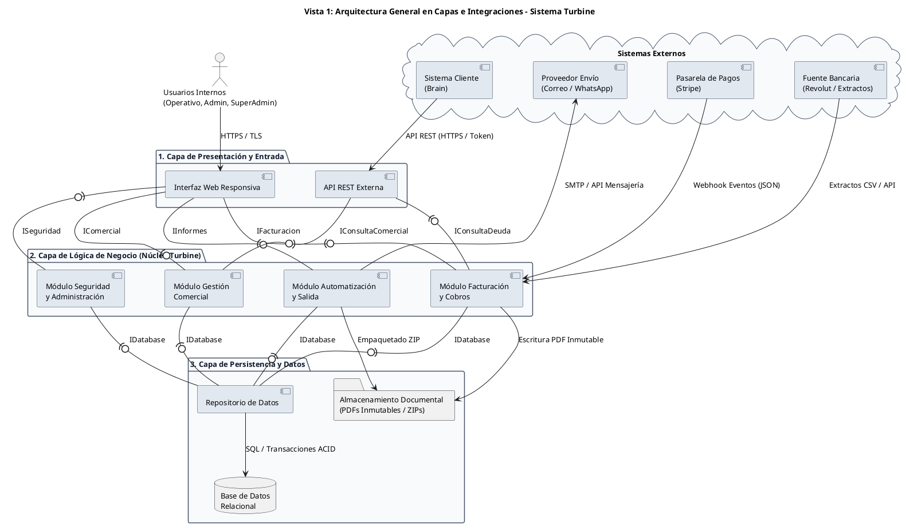
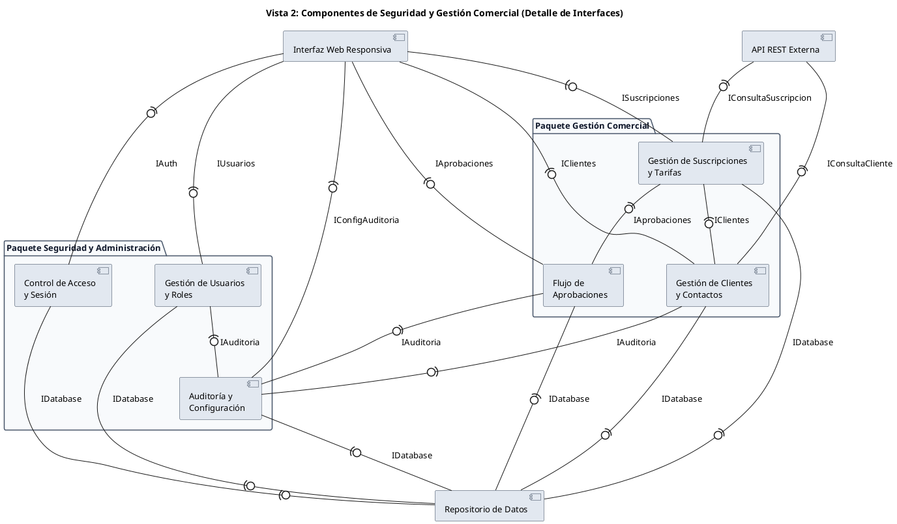
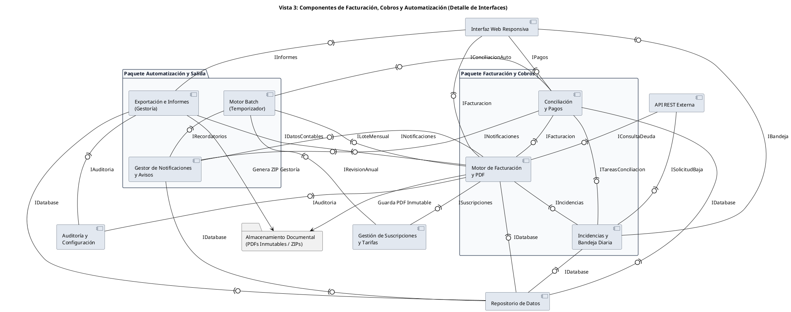

# Arquitectura y Diagramas de Componentes — Sistema Turbine (3 Vistas)

Este documento presenta el diseño arquitectónico del sistema **Turbine** siguiendo el enfoque de **Vistas Múltiples / Modelo C4** y el patrón de **Arquitectura en Capas (*n-tier*)** combinada con procesamiento orientado a eventos, garantizando bajo acoplamiento, alta cohesión y cumplimiento estricto de las restricciones de acceso a datos.

---

## Vista 1: Arquitectura General en Capas e Integraciones Externas (Nivel Macro)

Muestra la topología global del sistema dividida en **3 capas** (Presentación, Lógica de Negocio y Persistencia), los conectores externos (HTTPS, API REST, Webhooks, SMTP) y la restricción arquitectónica de que ninguna capa superior accede directamente a la base de datos, pasando obligatoriamente por el `Repositorio de Datos` (`IDatabase`).

### Elementos y decisiones clave de la Vista 1:
* **Arquitectura en Capas (*n-tier*):** Separa la interfaz de usuario (`Interfaz Web` y `API REST`), las reglas de negocio (`Núcleo Turbine`) y la persistencia (`Repositorio de Datos`, `Base de Datos` y `Almacenamiento Documental`).
* **Orientación a Eventos:** Los cobros de `Stripe` entran de forma asíncrona mediante *Webhooks* hacia el módulo de facturación y cobros.
* **Restricción de seguridad y consistencia:** La presentación nunca toca la base de datos ni el almacenamiento documental directamente; todo se canaliza mediante interfaces explícitas (*ball-and-socket* `-(0-`).

---

## Vista 2: Componentes de Seguridad y Gestión Comercial (Detalle de Interfaces)

Desglosa los paquetes internos de **Seguridad y Administración** y **Gestión Comercial**, detallando las interfaces proporcionadas (`0`) y requeridas (`(`) para el control de sesiones, gestión de usuarios, auditoría inmutable, cartera de clientes, suscripciones y aprobaciones por umbral.

### Responsabilidades de los componentes (Vista 2):
* **Control de Acceso y Sesión (`IAuth`):** Valida el inicio de sesión corporativo sin autorregistro, controla tokens, expiración por inactividad y ámbito de acceso por cartera (CU-28).
* **Gestión de Usuarios y Roles (`IUsuarios`):** Gestiona la jerarquía (`Operativo` $\rightarrow$ `Admin` $\rightarrow$ `SuperAdmin`) y la delegación/reasignación de clientes sin dejar fichas huérfanas (CU-29, CU-30).
* **Auditoría y Configuración (`IConfigAuditoria` / `IAuditoria`):** Registra de forma inmutable acciones críticas y cambios económicos con motivo obligatorio (CU-32), y permite al `SuperAdmin` parametrizar tarifas, umbrales y festivos (CU-31).
* **Gestión de Clientes y Contactos (`IClientes` / `IConsultaCliente`):** Ejecuta altas manuales y por CSV (CU-01, CU-02), detecta duplicados por NIF/razón social sin fusiones automáticas (CU-03) y expone consultas controladas a la API externa (CU-33).
* **Gestión de Suscripciones y Tarifas (`ISuscripciones` / `IConsultaSuscripcion`):** Administra planes, prorrateos por días naturales reales (CU-04, CU-05), pausas con revisión programada (CU-06) y bajas comerciales (CU-07).
* **Flujo de Aprobaciones (`IAprobaciones`):** Evalúa los umbrales configurados ante descuentos o tarifas especiales y gestiona su resolución con separación de funciones (CU-09).

---

## Vista 3: Componentes de Facturación, Cobros y Automatización (Detalle de Interfaces)

Detalla el núcleo operativo de **Facturación y Cobros** y **Automatización y Salida**, mostrando la coordinación entre emisión de facturas, conciliación de pagos, bandeja diaria de incidencias, el motor batch temporizado y la exportación documental.

### Responsabilidades de los componentes (Vista 3):
* **Motor de Facturación y PDF (`IFacturacion` / `ILoteMensual` / `IConsultaDeuda`):** Emite facturas ordinarias, puntuales y rectificativas (CU-10, CU-11, CU-13), asigna numeración correlativa atómica (CU-12), congela el PDF inmutable en almacenamiento documental y gestiona cierres de periodo y deuda incobrable con auditoría (CU-14, CU-27).
* **Conciliación y Pagos (`IPagos` / `IConciliacionAuto`):** Procesa eventos idempotentes de Stripe (CU-18), importa extractos bancarios (CU-19) y concilia automáticamente solo ante coincidencia exacta, derivando discrepancias a revisión manual (CU-20).
* **Incidencias y Bandeja Diaria (`IBandeja` / `IIncidencias` / `ITareasConciliacion` / `ISolicitudBaja`):** Centraliza en una vista única fallos de entrega (CU-21), discrepancias de cobro, disputas pausadas (CU-17) y solicitudes de baja entrantes por API (CU-33 $\rightarrow$ CU-07), gestionando su ciclo de vida (`PENDIENTE` $\rightarrow$ `LEIDO` $\rightarrow$ `RESUELTO`, CU-22).
* **Motor Batch (`Temporizador`):** Orquesta de forma determinista y reintentable los procesos automáticos: revisión anual de tarifas (`IRevisionAnual`, CU-08), lote de facturación del día 1 (`ILoteMensual`, CU-10), cadencia diaria de recordatorios (`IRecordatorios`, CU-16) y conciliación automática (`IConciliacionAuto`).
* **Gestor de Notificaciones y Avisos (`INotificaciones` / `IRecordatorios`):** Renderiza plantillas multidioma (ES/EN), envía facturas y avisos por correo/WhatsApp y registra su estado real de entrega (CU-15, CU-16).
* **Exportación e Informes (`IInformes`):** Alimenta el dashboard financiero con KPIs trazables (CU-24), genera exportaciones auditadas en CSV/PDF (CU-25) y empaqueta en ZIP versionado la documentación contable para la gestoría externa (CU-26).