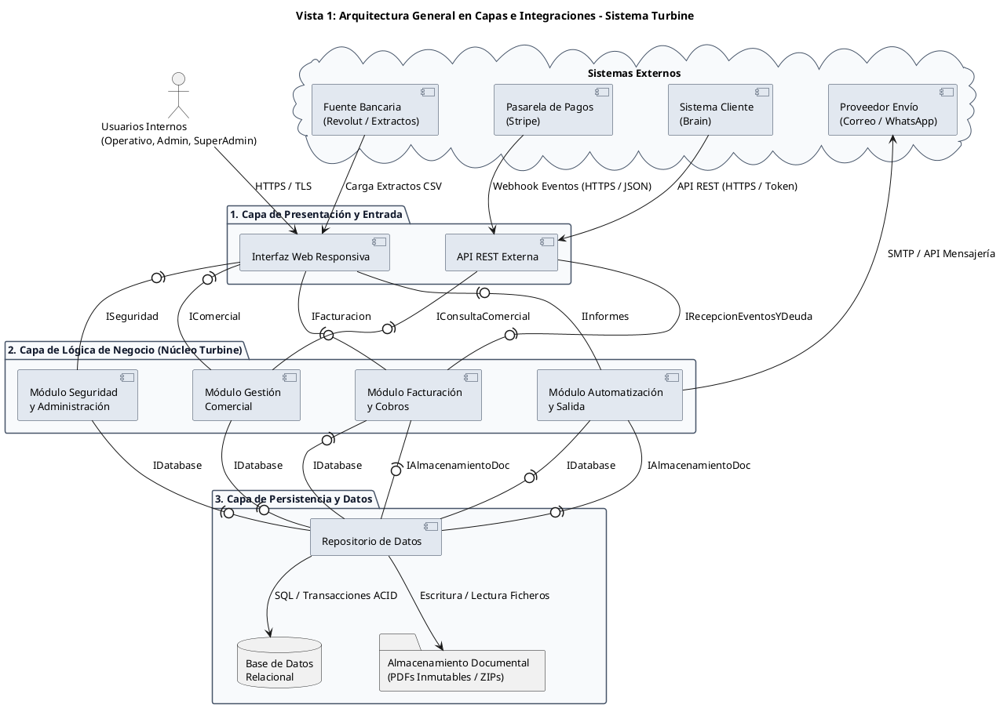
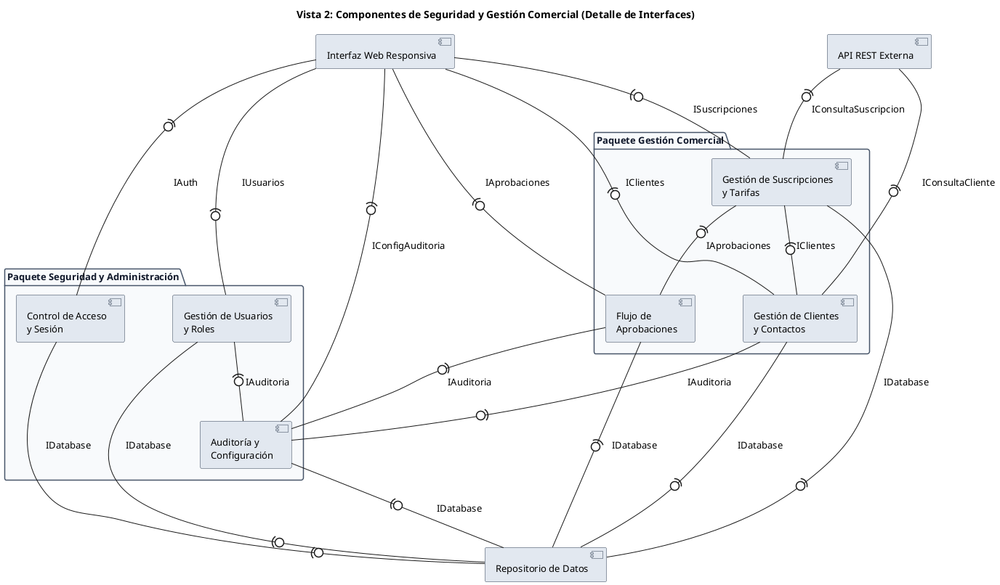
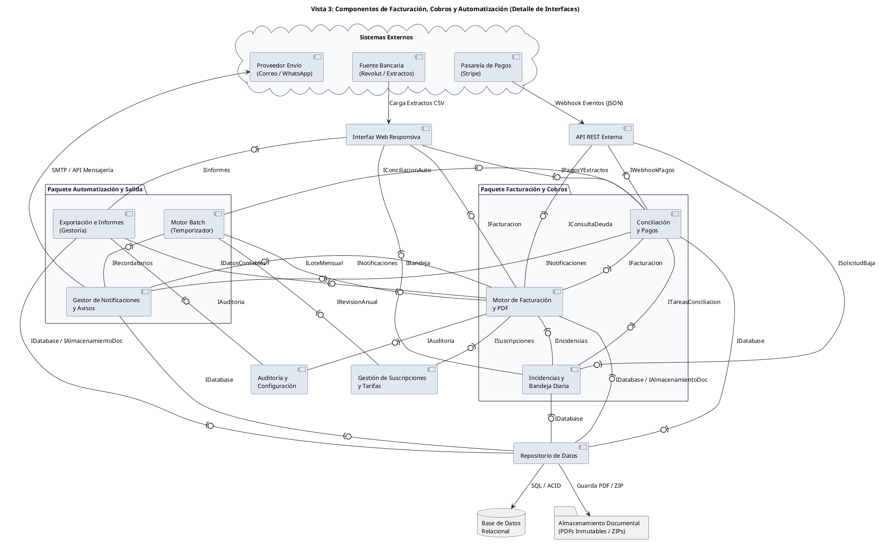

# Arquitectura y Diagramas de Componentes — Sistema Turbine

## Vista 1: Arquitectura General en Capas e Integraciones Externas

## Vista 2: Componentes de Seguridad y Gestión Comercial

## Vista 3: Componentes de Facturación, Cobros y Automatización

