## Parte 1: Gestión de Usuarios y Asignación de Clientes (CU-29 / CU-30 / CU-22)

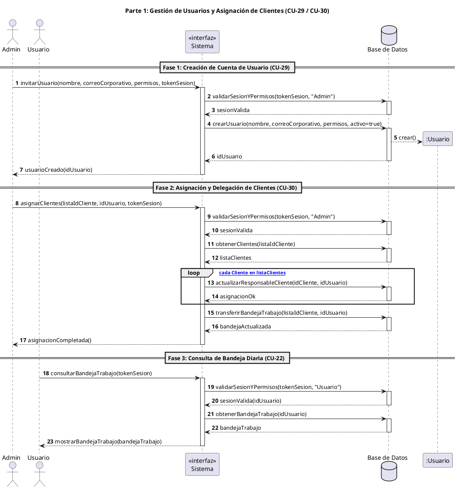

---

## Parte 2: Alta de Cliente y Detección de Duplicados (CU-01 / CU-03)

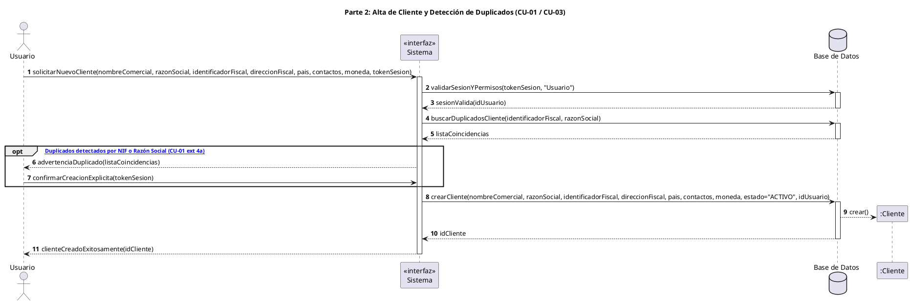

---

## Parte 3: Creación de Suscripción y Aprobación por Umbrales (CU-04 / CU-05 / CU-09)

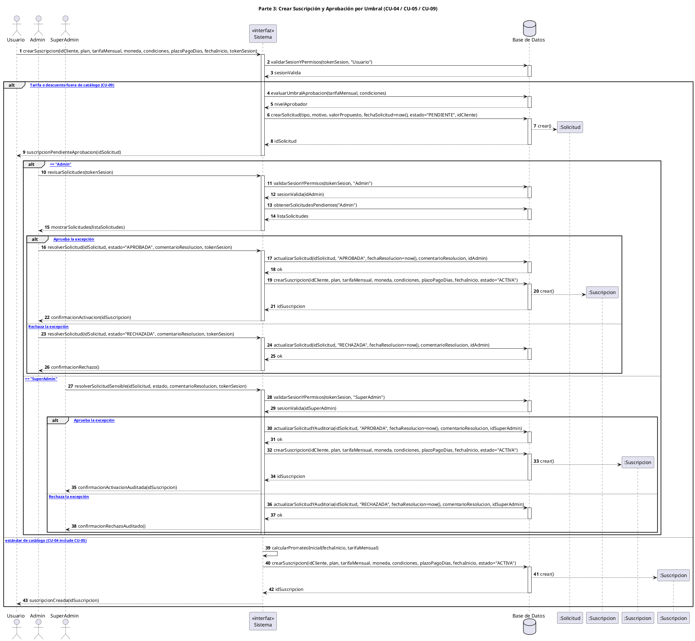

---

## Parte 4: Facturación Mensual Recurrente, Incidencias y Bandeja (CU-10 / CU-12 / CU-15 / CU-21 / CU-22)

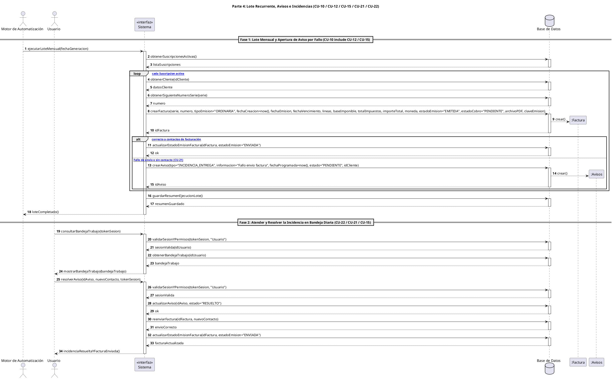

---

## Parte 5: Procesamiento de Pago Pasarela y Conciliación (CU-18 / CU-20 / CU-22)

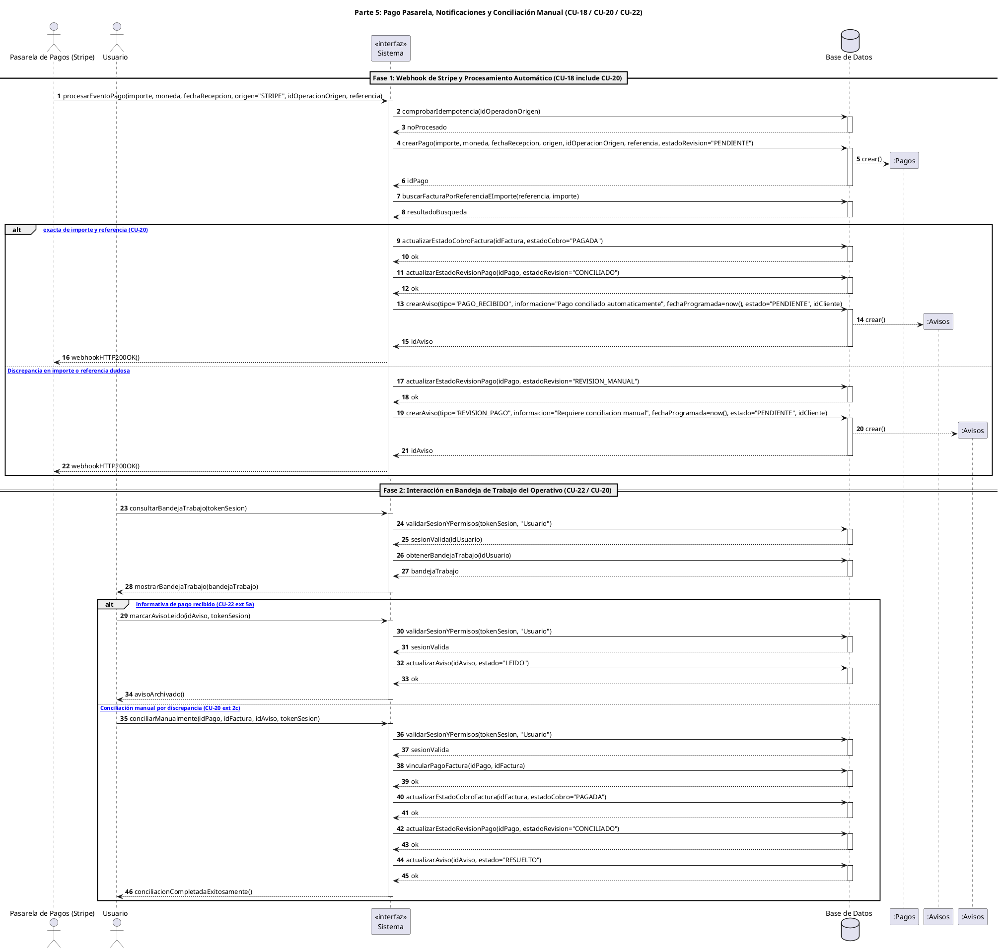

---

## Parte 6A: Importación Masiva de Clientes desde CSV (CU-02 / CU-03)

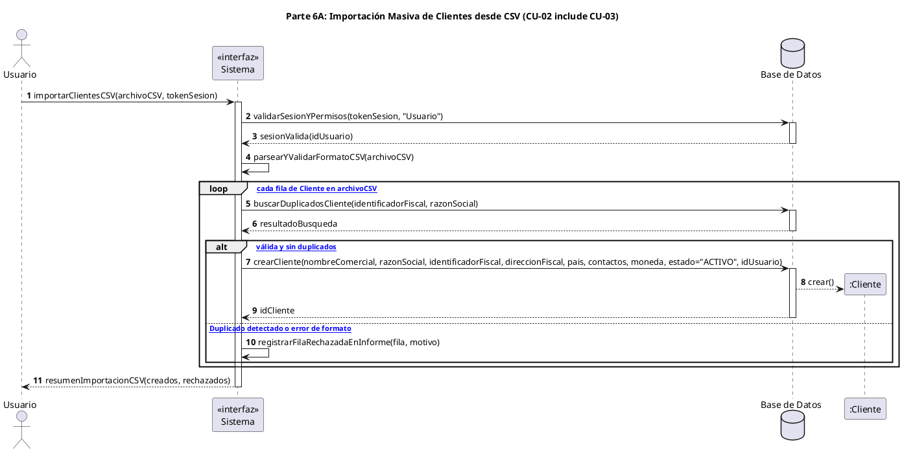

---

## Parte 6B: Importación de Extractos Bancarios y Conciliación (CU-19 / CU-20)

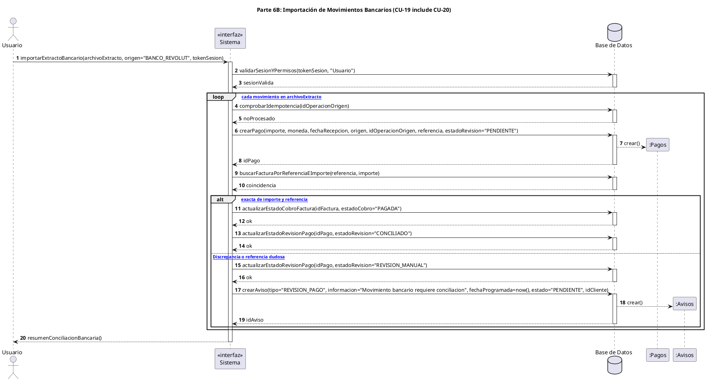

---

## Parte 7A: Pausar, Reactivar y Baja Comercial de Suscripción (CU-06 / CU-07)

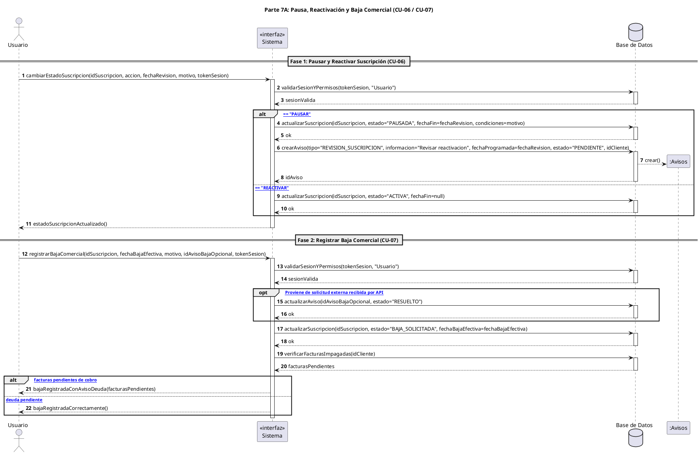

---

## Parte 7B: Revisión Anual Automática de Rango (CU-08 / CU-09)

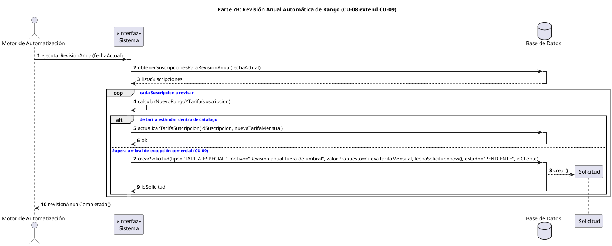

---

## Parte 8A: Facturación Puntual, Rectificativas y Deuda Incobrable (CU-11 / CU-13 / CU-14)

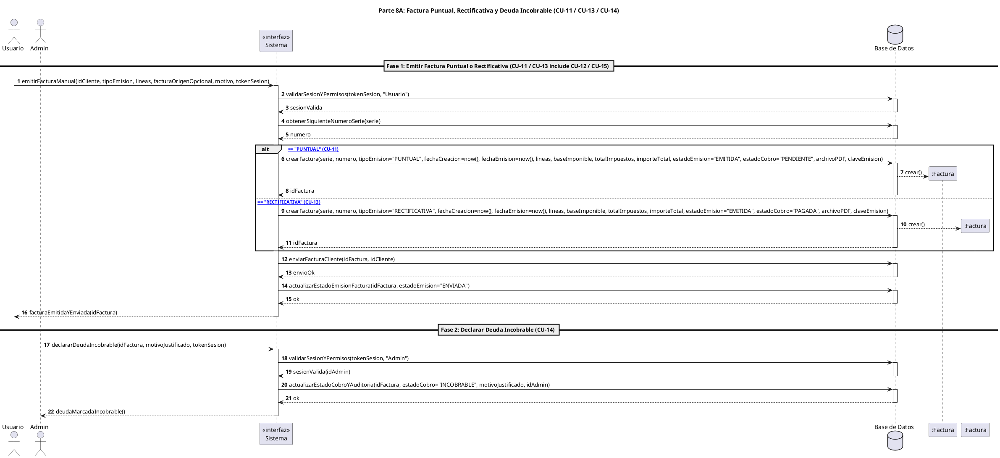

---

## Parte 8B: Gestión de Disputas y Lote Diario de Recordatorios (CU-16 / CU-17)

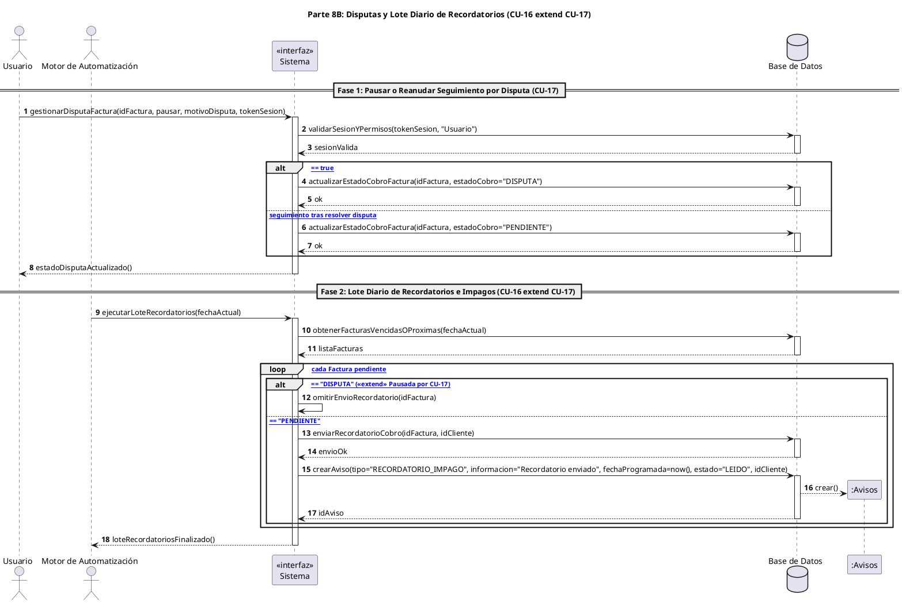

---

## Parte 9A: Inicio de Sesión, Consultas e Informes (CU-23 / CU-24 / CU-25 / CU-26 / CU-28)

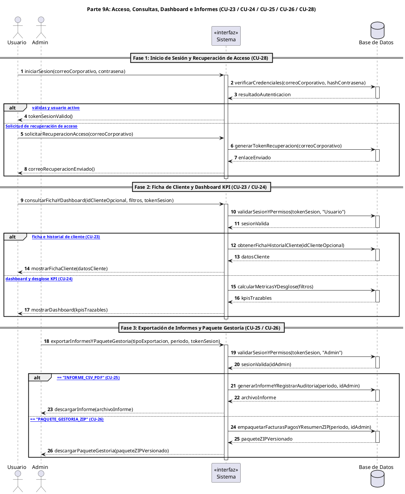

---

## Parte 9B: Administración del Sistema y API Externa (CU-27 / CU-31 / CU-32 / CU-33)

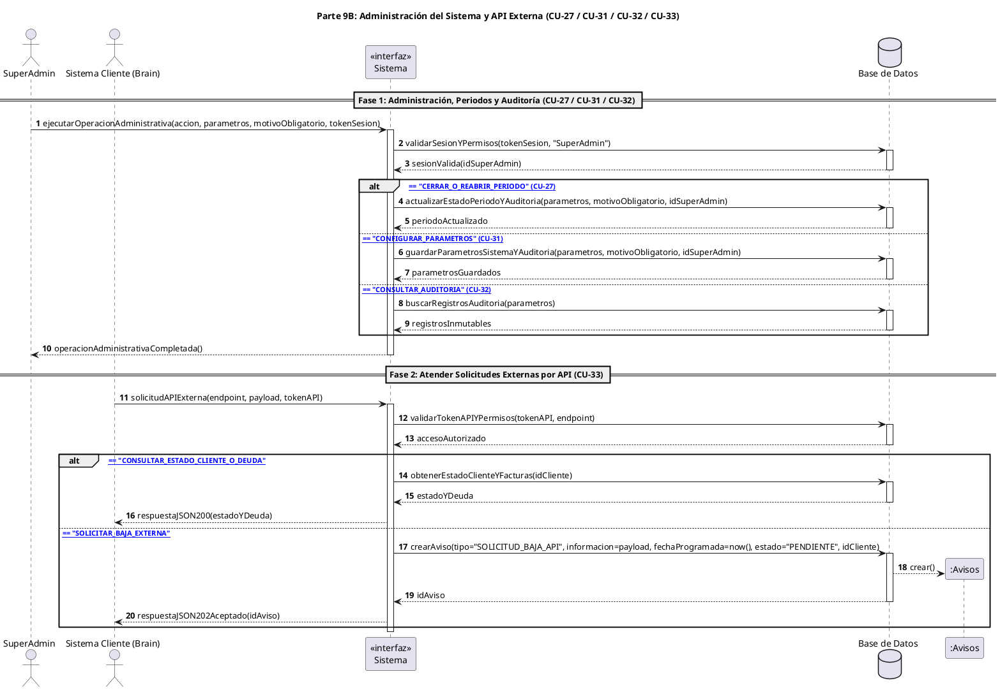
